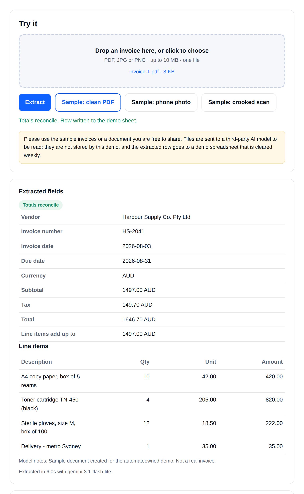
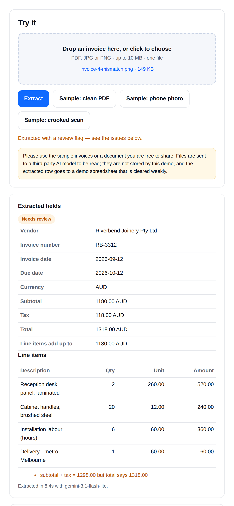
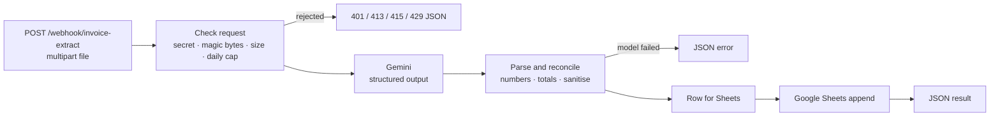

# Invoice → Google Sheet, with a totals check (n8n + vision LLM)

An n8n workflow that reads a supplier invoice (PDF, phone photo or crooked scan), extracts it into a strict JSON schema with a vision LLM, **checks in code that the numbers add up**, and appends one row to Google Sheets — flagged for review when they don't.

**Live demo:** https://invoice.automateowned.com (three sample invoices included, nothing is stored)

| Totals reconcile | Totals don't add up → held for review |
|---|---|
|  |  |

## Why the totals check matters

Most "AI OCR" flows write whatever the model returns. Models misread a digit now and then, and a wrong total in your books costs more than a blank one. Here the model only **reads**; plain JavaScript then checks:

- line items add up to the subtotal
- subtotal + tax = total
- vendor, date and total are present

If anything disagrees, the row is still written but with `reconciled = no` and the reason in `issues`, so a person only looks at the exceptions.

## How it works



- **11 nodes**, no community nodes.
- File type is checked by **magic bytes**, not the browser's Content-Type.
- A **daily cap** (default 60) is kept in workflow static data — no database.
- Strings are sanitised against **formula injection** before they reach the sheet.
- Every branch answers with JSON; the workflow never dies halfway.

## Setup (about 15 minutes)

1. **Gemini API key** from Google AI Studio. Set a spending limit first.
2. **Google Sheet** with a tab named `Invoices` and these 19 headers in row 1:
   `request_id, received_at, source, file_name, file_type, vendor, invoice_number, invoice_date, currency, subtotal, tax, total, line_item_count, reconciled, issues, model, latency_ms, tokens_in, tokens_out`
3. **Shared secret** for the webhook: `openssl rand -hex 24`
4. In n8n: **Import from File** → `workflow/invoice-to-sheet.n8n.json`, then:
   - **Check request** (Code): set `SHARED_SECRET`; optionally `MODEL`, `MAX_BYTES`, `DAILY_LIMIT`.
   - **Gemini extract**: create a *Header Auth* credential, name `x-goog-api-key`, value = your key.
   - **Log to Google Sheets**: pick your Google credential and replace `REPLACE_WITH_GOOGLE_SHEET_ID`.
   - Save and activate.

## Try it

```bash
curl -s -X POST https://YOUR-N8N-HOST/webhook/invoice-extract \
  -H "x-demo-secret: $SECRET" \
  -F "invoice=@samples/invoice-1.pdf;type=application/pdf" \
  -F "source=curl"
```

Response (shortened):

```json
{
  "ok": true,
  "vendor": "…", "invoice_number": "…", "invoice_date": "…", "currency": "AUD",
  "subtotal": 1497.0, "tax": 149.7, "total": 1646.7,
  "line_items": [{ "description": "…", "qty": 1, "unit_price": 0, "amount": 0 }],
  "validation": { "ok": true, "issues": [] },
  "sheet_written": true,
  "latency_ms": 9500
}
```

No file or an empty file → `400`, wrong secret → `401`, too big (over 10 MB) → `413`, not a real PDF/JPG/PNG → `415`, daily cap reached → `429`. All errors come back as JSON with `ok: false`.

## Samples

`samples/` holds three **fictional** invoices — a clean PDF (AUD), a tilted phone photo (USD) and a noisy skewed scan with a PAID stamp (EUR) — plus `make_samples.py` that generates them, so the numbers always add up. All companies, addresses and IDs are made up.

## Adapting it

Common changes: write to Airtable, Xero/QuickBooks or a database instead of Sheets; read invoices from a Gmail label or a Drive folder; add an approval step on Telegram/Slack for rows with `reconciled = no`; swap Gemini for another vision model.

Need it adapted to your documents and accounting tool? I build and host these for small businesses — [hire me on Upwork](https://www.upwork.com/freelancers/automateowned) · more demos at [automateowned.com](https://automateowned.com).

## License

MIT
